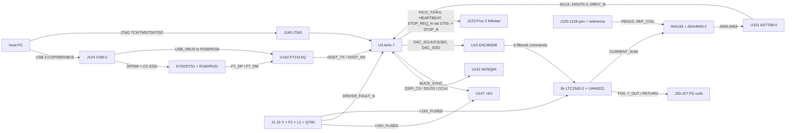

# BRD-01 input/output handoff — what reaches the FPGA and where the PC plugs in

**Audience:** the next engineer picking up BRD-01 (KiCad rev 0.1 engineering draft).
**Authority:** the KiCad netlist exported from `hardware/brd-01/kicad/brd-01.kicad_sch` with
`kicad-cli sch export netlist --format kicadxml` (KiCad 10.0.8). Where a document disagrees with
the netlist, the netlist is described here and the disagreement is listed in §7.
**Companion file:** `docs/handoff/brd01_io_handoff_signals.csv` has one row per FPGA node.
Sheet names below are KiCad sheet names: `power`, `driver`, `receiver`, `fpga`, `connectors`.

---

## 1. System boundary — what physically enters and leaves the chassis

| Designator | Physical type (value in netlist) | Carries | Direction | Sheet |
|---|---|---|---|---|
| `J1` | DC barrel jack, PJ-079BH | 15 V DC from the external medical 60 W adapter; pins 1 (+), 2 (return); pin 3 and shield are **no-connect** | in | `power` |
| `J750` | 2-pin terminal block, 1715721 | pin 1 on `+15V_FUSED`; **pin 2 is a no-connect** (no panel E-stop relay loop is wired) | in | `power` |
| `SW750` | on-board rearm pushbutton, B3F-1002-G | arm latch clock through R752/C755 → U754 → U753.C | in (local) | `power` |
| `J20`–`J27` | 2-pin keyed FG headers, Molex 39-30-1020 | one coil pair each: `FG0_OUT`…`FG7_OUT` (drive, pin 1) and `FG0_RETURN`…`FG7_RETURN` (sense return, pin 2) to/from FG-01 | out + in (bidirectional pair) | `connectors` |
| `J120`, `J125` | panel mini-XLR, IO-TXLR3-M-PS-1 | pen 1 / pen 2 coil pair on pins 2/3; pin 1 and shell to `/connectors/CHASSIS` | in (analog), shield out | `connectors` |
| `J121`, `J126` | JST PHR-2 harness plugs | internal harness from the panel XLRs; `PEN1_PANEL_P/N`, `PEN2_PANEL_P/N` | in (harness) | `connectors` |
| `J122`, `J127` | on-board JST B2B-PH-K-S headers | pen 1 / pen 2 to receiver: `PEN1_P/N`, `PEN2_P/N` (Ch1/Ch2) | in | `connectors` |
| `J128` | 2-pin JST BM02B-GHS-TBT | fixed reference coil: `REF_COIL_P/N` (Ch3) | in | `connectors` |
| `J123` | 6-pin JST BM06B-GHS-TBT | Pico 2 follower link: pin 2 GND, pin 3 `PICO_TX`, pin 4 `PICO_RX`, pin 5 `PICO_STOP_N`, pin 6 `PICO_HEARTBEAT`; **pin 1 (3V3) is not wired** | bidirectional | `connectors` |
| `J124` | USB-C receptacle, USB4110-GF-A | USB 2.0 `USB_DP`/`USB_DM`, `USB_VBUS`, CC1/CC2, shield; SBU1/SBU2 no-connect | bidirectional (host PC) | `connectors` |
| `J140` | 14-pin JTAG header, 87831-1420 | `JTAG_TCK/TMS/TDI/TDO`, VREF on pin 2, GND on 3/5/7/9/11; pins 1/12/13/14 no-connect | bidirectional (program/debug) | `fpga` |
| `U141` | W25Q64JVSSIQ QSPI flash — **on board, not a chassis connector** | configuration image; `QSPI_CS`, `QSPI_D0`…`D3`, `CCLK_SRC` | internal (listed because it is the config boundary) | `fpga` |
| `TP200`–`TP203`, `TP790`–`TP792`, `TP821`/`TP822` | on-board test points | DAC SPI, FPGA config status, FG ch0 drive/return | internal only, no off-board cable | `driver`, `fpga` |

Nothing else in the netlist leaves the board: there is no separate earth stud, no fan/power
connector beyond `J1`, and no ADC/DAC ribbon (all four ADC lanes and the DAC SPI are on-board
traces). The only chassis/shield net is `/connectors/CHASSIS`, tied to `J120`, `J125` and `J124`
shells/pin 1; **it has no connection to `GND` on any sheet** — see §7.

---

## 2. Power inputs (context, not FPGA signals)

The 15 V path is `J1` → `F1` (Schurter 0031.8201 holder with 3.15 A time-delay cartridge — a
recorded 5 % deviation from the 3.00 A spec) → `L1` common-mode choke → `Q760` reverse-polarity
PMOS → `L760` + `C770` filter → `+15V_FUSED`, with `D1` SMBJ18A TVS and `C30` reservoir to GND.
`+15V_FUSED` feeds the `+6V` pre-regulator `U147` TPSM63604, the isolated
`U5` MGJ2D151515SC (±15 V) and the eight LMH6321 coil loops **directly** — the
field rail is unswitched. The arm latch (U751–U755, rearm via `SW750`) gates only
`PICO_STOP_N` to the follower; `J750.2` is a no-connect. There is no K1/K2 relay
and no panel E-stop on BRD-01.

| Rail | Made by | Feeds (relevant to I/O) |
|---|---|---|
| `+6V` | `U147` from `+15V_FUSED` | `U144`/`U145`/`U7` buck inputs, `U146`/`U149` LDO inputs, `U147` VLDOIN |
| `+1V0_FPGA` | `U144` TPS62130 from `+6V`, EN = `PG_6V` | U4 VCCINT/VCCBRAM |
| `+1V8_FPGA` | `U145` from `+6V`, EN = `PG_1V0` | U4 VCCAUX/VCCADC |
| `+3.3V` | `U7` TPS62130 from `+6V`, EN = `PG_1V8` | U4 VCCO (banks 14/15/34/35), `U141`, `U142`, `Y1`, `J140` VREF, DAC VIO, ADC IOVDD, ESD/latch logic |
| `+5V_EXC` | `U149` TPS7A4701 from `+6V` | DAC80508 VDD, 8× LTC1563-2 |
| `+5VA` | `U146` TPS7A4701 from `+6V` via FL2 | AD7768-4 AVDD, ADA4940-2, analog front ends |
| `+15V`/`−15V` | `U5` MGJ2 from `+15V_FUSED` | `U6` LT3045-1 → `+12VA`, `U2` LT3093 → `−12VA` (op-amps, INA163, ADR434) |
| `+15V_FUSED` | J1 → F1 → L1 → Q760 → L760 | unswitched: eight LMH6321 coil drivers, driver bias, `U147` → +6V (→ U146/U149), `U5` MGJ2 |
| `GND` | one net everywhere | all returns, including U4 VCCBATT |

`U5`'s COM and −VIN are tied to `GND`, so the isolated module does **not** create a separate
analog ground; separation is a layout task. Star point and shield bonding are described in
`docs/phase2/system_schematic.md` §8; shield-can/chassis bond details remain open.

---

## 3. FPGA inputs and outputs — complete signal list

The netlist has **256 `U4` nodes**: 49 signals, 36 supply-rail pins, 32 GND pins and 139
`no_connect` pins. Every signal below is one of those 49 nodes, enumerated from the netlist (not
picked off the drawing). The companion CSV has all **256** rows (`include_in_section3=yes` only
for these 49); rails, decoupling and GND are deliberately excluded from this table because they
are not signals. Directions are from the FPGA's point of view; the KiCad symbol marks every pin
`bidirectional`, so direction is resolved from the named net and the part at the other end.
"Schematic I/O standard" is not captured per pin: the repo states 3.3 V HR banks (Banks 14, 15,
34) and 3.3 V LVCMOS for the DAC and Pico interfaces, but there is no per-pin IOSTANDARD
constraint file in this repo.

#### clocking

| FPGA ball | Net | Direction | I/O standard | Other end (part.pin, sheet) | Meaning |
|---|---|---|---|---|---|
| `C11` | `ADC_DCLK` | clock in | 3.3 V LVCMOS (HR) | U101.28 (receiver) | 8.192 MHz ADC serial clock from AD7768-4 U101.28; 4-lane data strobe |
| `D13` | `CLOCK_32M768` | clock in | 3.3 V LVCMOS (HR) | R100.1 (receiver); Y1.3 (fpga) | 32.768 MHz XO Y1.3; also fanned to AD7768-4 MCLK via R100 33 ohm on receiver sheet |

#### config/QSPI/JTAG

| FPGA ball | Net | Direction | I/O standard | Other end (part.pin, sheet) | Meaning |
|---|---|---|---|---|---|
| `E7` | `/fpga/CFGBVS` | config in | 3.3 V config (HR) | R154.2 (fpga) | bank voltage select strap via R154 0 ohm to +3.3 V |
| `E8` | `/fpga/CCLK_SRC` | config out | 3.3 V config (HR) | R790.1 (fpga) | source clock for QSPI flash U141.6 via R790 0 ohm at the FPGA; tune source termination |
| `H10` | `/fpga/DONE` | config out | 3.3 V config (HR) | R143.2 (fpga); TP792.1 (fpga) | configuration-done open-drain status with R143 4.7 kohm pull-up and test point TP792 |
| `J13` | `/fpga/QSPI_D0` | config bidir | 3.3 V config (HR) | U141.5 (fpga) | QSPI data 0 / MOSI to config flash U141.5 |
| `J14` | `/fpga/QSPI_D1` | config bidir | 3.3 V config (HR) | U141.2 (fpga) | QSPI data 1 / MISO from config flash U141.2 |
| `K10` | `/fpga/INIT_N` | config bidir | 3.3 V config (HR) | R142.2 (fpga); TP791.1 (fpga) | INIT_B open-drain status/strap with R142 4.7 kohm pull-up and test point TP791 |
| `K15` | `/fpga/QSPI_D2` | config bidir | 3.3 V config (HR) | R148.2 (fpga); U141.3 (fpga) | QSPI data 2 / WP_N from config flash U141.3; R148 4.7 kohm pull-up |
| `K16` | `/fpga/QSPI_D3` | config bidir | 3.3 V config (HR) | R149.2 (fpga); U141.7 (fpga) | QSPI data 3 from config flash U141.7; R149 4.7 kohm pull-up |
| `L12` | `/fpga/QSPI_CS` | config out | 3.3 V config (HR) | R140.2 (fpga); U141.1 (fpga) | chip select to config flash U141.1; R140 4.7 kohm pull-up |
| `L15` | `/fpga/PUDC_N` | config in | 3.3 V config (HR) | R141.2 (fpga) | pull-up enable during configuration via R141 4.7 kohm to +3.3 V |
| `L7` | `/fpga/JTAG_TCK` | config in | 3.3 V config (HR) | J140.6 (fpga) | JTAG clock from header J140.6 |
| `L9` | `/fpga/PROGRAM_N` | config bidir | 3.3 V config (HR) | R144.2 (fpga); TP790.1 (fpga) | reprogram request, open-drain, with R144 4.7 kohm pull-up and test point TP790 |
| `M10` | `/fpga/MODE1` | config in | 3.3 V config (HR) | R156.2 (fpga) | QSPI boot mode strap M1 via R156 0 ohm |
| `M11` | `/fpga/MODE2` | config in | 3.3 V config (HR) | R157.2 (fpga) | QSPI boot mode strap M2 via R157 0 ohm |
| `M7` | `/fpga/JTAG_TMS` | config in | 3.3 V config (HR) | J140.4 (fpga) | JTAG mode select from header J140.4 |
| `M9` | `/fpga/MODE0` | config in | 3.3 V config (HR) | R155.2 (fpga) | QSPI boot mode strap M0 via R155 0 ohm |
| `N7` | `/fpga/JTAG_TDI` | config in | 3.3 V config (HR) | J140.10 (fpga) | JTAG data in from header J140.10 |
| `N8` | `/fpga/JTAG_TDO` | config out | 3.3 V config (HR) | J140.8 (fpga) | JTAG data out to header J140.8 |

#### host UART

| FPGA ball | Net | Direction | I/O standard | Other end (part.pin, sheet) | Meaning |
|---|---|---|---|---|---|
| `N1` | `HOST_TX` | out | 3.3 V LVCMOS (HR) | U142.1 (fpga) | FPGA UART TX to FT231XQ U142.1 RXD; host pose log / calibration link |
| `P1` | `HOST_RX` | in | 3.3 V LVCMOS (HR) | U142.17 (fpga) | FPGA UART RX from FT231XQ U142.17 TXD; host config/commands |

#### DAC control (SPI)

| FPGA ball | Net | Direction | I/O standard | Other end (part.pin, sheet) | Meaning |
|---|---|---|---|---|---|
| `L4` | `/fpga/DAC_SDI_SRC` | out | 3.3 V LVCMOS (HR) | R147.1 (fpga) | DAC MOSI, R147 33 ohm at the FPGA then global DAC_SDI to U10.14 on driver sheet |
| `M1` | `/fpga/DAC_SCLK_SRC` | out | 3.3 V LVCMOS (HR) | R146.1 (fpga) | 49.152 MHz DAC SPI clock, R146 33 ohm at the FPGA then global DAC_SCLK to U10.13 on driver sheet |
| `M2` | `/fpga/DAC_CS_SRC` | out | 3.3 V LVCMOS (HR) | R145.1 (fpga) | DAC chip select, R145 33 ohm at the FPGA then global DAC_CS to U10.12 on driver sheet; R162 10 kohm pull-up |
| `M4` | `DAC_SDO` | in | 3.3 V LVCMOS (HR) | TP203.1 (driver); U10.15 (driver) | optional DAC80508 readback from U10.15 / TP203; diagnostic only |

#### ADC control and data

| FPGA ball | Net | Direction | I/O standard | Other end (part.pin, sheet) | Meaning |
|---|---|---|---|---|---|
| `A10` | `ADC_DOUT3` | in | 3.3 V LVCMOS (HR) | U101.24 (receiver) | ADC lane 3, Ch3 fixed reference coil, from U101.24 |
| `A12` | `ADC_SDI` | out | 3.3 V LVCMOS (HR) | U101.18 (receiver) | AD7768-4 configuration SPI data in U101.18 |
| `A13` | `ADC_SCLK` | out | 3.3 V LVCMOS (HR) | U101.17 (receiver) | AD7768-4 configuration SPI clock U101.17 |
| `A14` | `ADC_RESET_N` | out | 3.3 V LVCMOS (HR) | R163.2 (fpga); U101.30 (receiver) | AD7768-4 active-low reset U101.30; R163 10 kohm pull-up |
| `A15` | `ADC_SYNC_OUT` | in | 3.3 V LVCMOS (HR) | U101.38 (receiver) | ADC sync echo U101.38 |
| `A8` | `ADC_DOUT0` | in | 3.3 V LVCMOS (HR) | U101.27 (receiver) | ADC lane 0, Ch0 current-sense summer, from U101.27 |
| `A9` | `ADC_DOUT1` | in | 3.3 V LVCMOS (HR) | U101.26 (receiver) | ADC lane 1, Ch1 pen 1, from U101.26 |
| `B10` | `ADC_DRDY_N` | in | 3.3 V LVCMOS (HR) | U101.29 (receiver) | AD7768-4 active-low data-ready U101.29; count after one-time sync |
| `B11` | `ADC_SDO` | in | 3.3 V LVCMOS (HR) | U101.19 (receiver) | AD7768-4 configuration SPI data out U101.19 |
| `B12` | `ADC_CS` | out | 3.3 V LVCMOS (HR) | R164.2 (fpga); U101.16 (receiver) | AD7768-4 SPI chip select U101.16; R164 10 kohm pull-up |
| `B14` | `ADC_START_N` | out | 3.3 V LVCMOS (HR) | R165.2 (fpga); U101.37 (receiver) | one-time ADC start U101.37; R165 10 kohm pull-up |
| `B9` | `ADC_DOUT2` | in | 3.3 V LVCMOS (HR) | U101.25 (receiver) | ADC lane 2, Ch2 pen 2, from U101.25 |
| `C14` | `ADC_SYNC_IN` | out | 3.3 V LVCMOS (HR) | R166.2 (fpga); U101.36 (receiver) | one-time ADC sync U101.36; R166 10 kohm pull-up |

#### E-stop/status

| FPGA ball | Net | Direction | I/O standard | Other end (part.pin, sheet) | Meaning |
|---|---|---|---|---|---|
| `H7` | `/fpga/XADC_VNREF` | analog in | analog XADC | R150.1 (fpga) | XADC negative reference via R150 0 ohm; no source stated in the repo |
| `H8` | `/fpga/XADC_VP` | analog in | analog XADC | R151.1 (fpga) | XADC analog positive input via R151 0 ohm; no source/sensor stated in the repo |
| `J7` | `/fpga/XADC_VN` | analog in | analog XADC | R152.1 (fpga) | XADC analog negative input via R152 0 ohm; no source/sensor stated in the repo |
| `J8` | `/fpga/XADC_VPREF` | analog in | analog XADC | R153.1 (fpga) | XADC positive reference via R153 0 ohm; no source stated in the repo |
| `R1` | `/DRIVER_FAULT_N` | in | 3.3 V LVCMOS (HR) | R712.2 (driver); U600.4 (driver); U600.6 (driver); U601.4 (driver); U601.6 (driver); U602.4 (driver); U602.6 (driver); U603.4 (driver); U603.6 (driver); U752.2 (power) | active-low wired-OR coil overcurrent bus from open-drain U600-U603, also clears the arm latch at U752.2 |

No E-stop status signal reaches U4: `U4.R2` is the no-connect
`unconnected-(U4B-IO_L7P_T1_34-PadR2)`. The hardware arm latch gates the STOP
level to the Pico through `U755`; see §7.B.

#### power-good/sync

| FPGA ball | Net | Direction | I/O standard | Other end (part.pin, sheet) | Meaning |
|---|---|---|---|---|---|
| `R3` | `/BUCK_SYNC` | out | 3.3 V LVCMOS (HR) | C809.1 (power) | 1.024 MHz sync (32.768/32) via C809 1 nF to U147 TPSM63604 EN/SYNC; no power-good net reaches U4 |

#### Pico link

| FPGA ball | Net | Direction | I/O standard | Other end (part.pin, sheet) | Meaning |
|---|---|---|---|---|---|
| `N2` | `PICO_TX` | out | 3.3 V LVCMOS (HR) | J123.3 (connectors) | UART TX to Pico follower header J123.3 |
| `N3` | `PICO_RX` | in | 3.3 V LVCMOS (HR) | J123.4 (connectors) | UART RX from Pico follower header J123.4 |
| `P3` | `PICO_HEARTBEAT` | out | 3.3 V LVCMOS (HR) | J123.6 (connectors) | 100 Hz heartbeat toggle to Pico header J123.6 |
| `P4` | `PICO_STOP_REQ_N` | out | 3.3 V LVCMOS (HR) | U755.1 (power); R754.1 (power) | active-low STOP request to U755.1 (74LVC1G08); R754 100 kohm pull-down holds it low while the FPGA is unconfigured; U755.4 drives `PICO_STOP_N` to J123.5 |

---

## 4. UART to the PC, end to end

```
J124 USB-C -> D750/D751 ESD -> R160/R161 27 ohm -> U142 FT231XQ -> HOST_TX/HOST_RX -> U4 N1/P1
J124 VBUS  -> R158 4.7k / R159 10k divider  -> U142.7 CBUS2 (VBUS sense)
```

| Stage | Net / part | Detail from netlist and docs |
|---|---|---|
| Receptacle | `J124` USB4110-GF-A | `USB_DP` on A6/B6, `USB_DM` on A7/B7, `USB_VBUS` on A4/A9/B4/B9, CC1 on A5, CC2 on B5, shield on SH; SBU1/SBU2 no-connect |
| ESD | `D750`, `D751` (TPD2EUSB30DRTR, 2×) | `D750` clamps DP/DM; `D751` clamps CC1/CC2; both sit at the connector on the `connectors` sheet |
| Series / loading | `R160`, `R161` = 27 Ω; `C173`, `C174` = 47 pF | 27 Ω at the FPGA sheet between `USB_DP`/`USB_DM` and the bridge's `FT_DP`/`FT_DM`; 47 pF from each bridge side to GND |
| Bridge | `U142` = FT231XQ (QFN-20) | `U142.8` USBDP, `U142.9` USBDM, `U142.1` RXD, `U142.17` TXD; VCC/VCCIO/~RESET/3V3OUT tied to `+3.3V` |
| UART to FPGA | `HOST_TX` (`U4.N1` → `U142.1` RXD), `HOST_RX` (`U4.P1` ← `U142.17` TXD) | 3.3 V LVCMOS; no level translation |
| VBUS detection | `R158` 4.7 kΩ from `USB_VBUS` to `/fpga/VBUS_SENSE`, `R159` 10 kΩ to GND, to `U142.7` CBUS2 | `hardware/brd-01/kicad/README.md` says to program CBUS2 for VBUS sensing and the self-powered descriptor |
| CC resistors | `R182`, `R183` = 5.1 kΩ to GND on CC1/CC2 with `D751` ESD | present in the netlist; the repo does not state an attach-detection function for them |
| Flow control | none to the FPGA | `U142.2` ~RI, `.4` ~DSR, `.5` ~DCD, `.6` ~CTS are tied to `+3.3V`; `.14` CBUS1, `.15` CBUS0, `.16` CBUS3, `.18` ~DTR, `.19` ~RTS are no-connect |

**Baud:** the repo does not state an operating baud for the host link. The only documented
constraint is "UART/USB, < 1 Mbit/s" for the host link in
`docs/phase2/fpga_integration_options.md` (item 6, host-link choice); the 1 Mbaud default in
`contract/icd/pico_link.md` §2 is the **Pico** link, not this one. FT231XQ device capability is
referenced as FTDI `DS_FT231X` v1.4 through `docs/reference/MANIFEST.md` (REF-14, local-only PDF);
no numeric maximum is quoted in a tracked repo file. Treat the operating rate as **not
determined** until a host-protocol document fixes it.

**Attach detection:** the only captured electrical indication of "USB attached" is VBUS through
the `R158`/`R159` divider into CBUS2; CC resistors are present but no code or document describes
using them for attach detection. There is no dedicated USB-attached signal to U4.

**Is this the only PC path?** No. `J140` is a second physical PC connection (JTAG,
program/debug, VREF from `+3.3V`). Application data (pose log, calibration UI) goes only over
the USB-UART; JTAG is not a second data path. `docs/handoff/m16-fpga-handoff.md` §1.1 assigns the
host PC logging/UI/camera and explicitly keeps the host out of the control loop.

---

## 5. Cross-sheet signal map (who owns each end)

**Hierarchical (root-sheet) signals.** Direction is from the sheet that drives the label; the
root sheet wires the two sheet pins between `power`, `fpga` and `driver`.

| Net | Driver end | Receiver end(s) | Root-sheet wiring |
|---|---|---|---|
| `DRIVER_FAULT_N` | `driver`: open-drain `U600`–`U603`, `R712` pull-up | `power`: `U752.2` (clears arm latch); `fpga`: `U4.R1` | driver out ↔ power in ↔ fpga in |
| `BUCK_SYNC` | `fpga`: `U4.R3` | `power`: `C809` 1 nF into `U147.14` EN/SYNC | fpga out ↔ power in |

`ESTOP_ASSERTED` is gone from the netlist and `U4.R2` is a no-connect; the arm
STOP latch gates `PICO_STOP_N` through `U755` (see §7.B).

**Global labels that land on more than one sheet (59 global nets plus the two
hierarchical signals = 61 crossing nets, grouped by boundary; see §7.B.9).**

| Sheets | Nets | Owner / direction |
|---|---|---|
| `fpga` ↔ `receiver` | `CLOCK_32M768`, `ADC_CS`, `ADC_SCLK`, `ADC_SDI`, `ADC_SDO`, `ADC_RESET_N`, `ADC_START_N`, `ADC_SYNC_IN`, `ADC_SYNC_OUT`, `ADC_DCLK`, `ADC_DRDY_N`, `ADC_DOUT0`, `ADC_DOUT1`, `ADC_DOUT2`, `ADC_DOUT3` | clock from `Y1`/`fpga`; all others between `U4` and `U101` |
| `driver` ↔ `fpga` | `DAC_CS`, `DAC_SCLK`, `DAC_SDI`, `DAC_SDO` | three outputs leave `U4` through R145/146/147; `DAC_SDO` returns from `U10` |
| `driver` ↔ `receiver` | `CURRENT_SUM` | `U38` summer output → `U101` Ch0 |
| `driver` ↔ `connectors` | `FG0_OUT`, `FG0_RETURN`, `FG1_OUT`, `FG1_RETURN`, `FG2_OUT`, `FG2_RETURN`, `FG3_OUT`, `FG3_RETURN`, `FG4_OUT`, `FG4_RETURN`, `FG5_OUT`, `FG5_RETURN`, `FG6_OUT`, `FG6_RETURN`, `FG7_OUT`, `FG7_RETURN` | driver outputs/returns → `J20`–`J27` |
| `receiver` ↔ `connectors` | `PEN1_P`, `PEN1_N`, `PEN2_P`, `PEN2_N`, `REF_COIL_P`, `REF_COIL_N` | `J122`/`J127`/`J128` into the INA163 front ends |
| `fpga` ↔ `connectors` | `PICO_TX`, `PICO_RX`, `PICO_HEARTBEAT`, `USB_DP`, `USB_DM`, `USB_VBUS` | `U4` ↔ `J123`; USB between `J124` and `U142` |
| `power` ↔ `connectors` | `PICO_STOP_N` | `U755.4` → `J123.5`; gated STOP level to the follower |
| `power` ↔ `driver` | `+15V_FUSED`, `+5V_EXC` | unswitched field rail → eight coil drivers; `U149` → DAC80508 + 8× LTC1563-2 |
| `power` ↔ `receiver` | `+5VA` | `U146` → ADC/analog |
| `power` ↔ `fpga` | `+1V0_FPGA`, `+1V8_FPGA`, `PICO_STOP_REQ_N` | `U144`/`U145` → `U4` core rails; `U4.P4` request → `U755.1` |
| `power`, `driver`, `receiver` | `+12VA`, `−12VA` | `U6`/`U2` → op-amps on both sheets |
| `power`, `driver`, `fpga`, `receiver` | `+3.3V` | `U7` → all digital |
| all sheets | `GND` | common return |

Local labels stay inside one sheet and are **not** cross-sheet connections: `/fpga/*` config and
`*_SRC` DAC nets, `/power/PG_*` and the arm latch nets, `/connectors/CHASSIS`,
`/connectors/PEN1_PANEL_P/N`, `/connectors/PEN2_PANEL_P/N`, `/connectors/USB_CC1/CC2`.

---

## 6. Signal-flow diagram


(16 nodes; simple quoted labels and `-->` / `<-->` edges only.)

---

## 7. Open items and schematic/doc disagreements

**A. Every `no_connect` on U4 (139 pins).** Each is a netlist `unconnected-(U4…)` node with a
deliberate no-connect marker on the `fpga` sheet; none is an omitted connection.
**Bank 35 pins (project README: user signals and QSPI use HR banks 14, 15, 34)** (50): A2, A3, A4, A5, A7, B1, B2, B4, B5, B6, B7, C1, C2, C3, C4, C6, C7, D1, D3, D4, D5, D6, E1, E2, E3, E5, E6, F2, F3, F4, F5, G1, G2, G4, G5, H1, H2, H3, H4, H5, J1, J3, J4, J5, K1, K2, K3, K5, L2, L3

**other bank 14/15/34 spares, unassigned** (82): B15, B16, C12, C13, C16, C8, C9, D10, D11, D14, D15, D16, D8, E11, E12, E13, E15, E16, F12, F13, F14, F15, G11, G14, G15, G16, H11, H12, H13, H14, H16, J15, J16, K12, K13, L13, L14, L5, M14, M15, M16, M5, M6, N11, N12, N13, N14, N16, N9, P10, P11, P13, P14, P15, P16, P5, P6, P8, P9, R10, R11, R12, R13, R15, R16, R2, R5, R6, R7, R8, T10, T12, T13, T14, T15, T2, T3, T4, T5, T7, T8, T9

**XADC VREF pins** (5): D9, G12, M12, N4, N6

**XADC external temperature diode pins (DXN/DXP)** (2): K7, K8

Per-pin reasons beyond these groupings are **not stated** in the repo. The project README says
"FPGA user signals and QSPI use 3.3 V HR Banks 14, 15 and 34", which is why all Bank 35 pins are
unassigned, but the remaining bank 14/15/34 spares and the XADC pins have no documented reason.

**B. Disagreements (netlist wins).**

1. **FPGA pin numbering.** `docs/phase2/system_schematic.md` §6 and `docs/handoff/m16-fpga-handoff.md`
   §8 use abstract sequential pins 1–40 (e.g. "pin 5 MCLK_ADC", "pin 37 ESTOP_STATUS"). The
   schematic uses real FTG256 balls: `D13` for `CLOCK_32M768`, `R1` for `DRIVER_FAULT_N`,
   `R3` for `BUCK_SYNC`, `P4` for `PICO_STOP_REQ_N`. Use the ball names in this document.
2. **E-stop/status naming.** Older M16 handoff text called them `ESTOP_STATUS`,
   `WATCHDOG_KICK` and `FAULT_IRQ`. The netlist has no `ESTOP_ASSERTED` net at all: `U4.R2` is now the no-connect
   `unconnected-(U4B-IO_L7P_T1_34-PadR2)`. `DRIVER_FAULT_N` (`R1`) remains and there is no
   `WATCHDOG_KICK` at U4. The Pico stop is split: `U4.P4` drives `PICO_STOP_REQ_N` into
   `U755.1` (with `R754` 100 kΩ pull-down to GND), and `PICO_STOP_N` is only `U755.4` →
   `J123.5`.
3. **Pico 3V3.** ICD and schematic disagree; the netlist is authoritative and pin 1 is
   no-connect; the ICD needs the correction. `contract/icd/pico_link.md` §2 lists a 6-pin
   connector with 3V3, and `hardware/brd-01/kicad/power-tree.md` §4 lists `+3.3V` on `J123`
   pin 1. The netlist has `unconnected-(J123-Pin_1-Pad1)`; BRD-01 does **not** power the Pico.
   `docs/phase2/power_tree_v2.md` §"+3.3V (digital)" and decision D4 explicitly record the
   no-connect and say the ICD changes in the same contract PR.
4. **Power rails.** `hardware/brd-01/kicad/power-tree.md` (banner: as-captured at `4da4e95`) shows
   `U3` OKI-78SR → `+5V`, `U1` TPS7A2033 → `+3.3V`, `U146` fed from `+15V_FUSED`, and RV-1515D
   ±15 V. The present netlist has `U147` TPSM63604 → `+6V`, `U7` TPS62130 → `+3.3V`, `U149`
   → `+5V_EXC`, `U146`/`U149` fed from `+6V`, and `U5` MGJ2D151515SC. `power_tree_v2.md` §2
   once proposed `U148` for 3.3 V; §9 and the netlist use `U7`.
5. **13-spare-pin claim.** `m16-fpga-handoff.md` §8 and `system_schematic.md` §6 list 13 spare
   pins from the M16 migration; the captured schematic leaves 139 U4 pins no-connect (many are
   unused Bank 35, not "freed by M16").
6. **Shield/chassis.** `hardware/brd-01/kicad/connectors.kicad_sch` text says to bond panel shell
   and pin 1 to chassis "at the feedthrough", but `/connectors/CHASSIS` has no bond to `GND` or
   any other net on any sheet; the actual chassis bond point is not captured.
7. **JTAG HALT.** `J140.14` (HALT) is no-connect; documents do not mention it.
8. **Switched driver rail — corrected.** §2, §5 and §6 now describe the captured
   `+15V_FUSED`: there is no `+15V_DRV` net. `+15V_FUSED` reaches the driver sheet
   directly and feeds `U20.7` (LMH6321 V+) and `U39.5` (OPA192 V+). The arm STOP
   latch gates only `PICO_STOP_N` (E-stop scope change). No K1/K2 relay remains.
9. **Cross-sheet net count.** The old §5 heading said 57 global cross-sheet nets.
   The netlist has 59 global plus 2 hierarchical labels (`DRIVER_FAULT_N`,
   `BUCK_SYNC`) = 61, and the old list omitted `+5V_EXC`; §5 is corrected.

**C. Specified but not wired / not determined.**

- Chassis/shield: `/connectors/CHASSIS` is unbonded in the captured netlist — no path to `GND`
  or any other net. It is tracked here as an open item; no fix is proposed, because the bond
  point is a grounding decision.
- Host UART operating baud: **not determined** (see §4). A host-link protocol document would settle it.
- USB attach detection: VBUS sense exists, CC-based detection is **not determined**; a
  firmware/bridge CBUS configuration document would settle it.
- XADC `VP/VN/VPREF/VNREF` (balls `H8`, `J7`, `J8`, `H7`) reach 0 Ω resistors but no source is
  named anywhere in the repo: **not determined**. A BRD-01 analog-monitoring section or the
  system-schematic §6 revision would settle it.
- `BUCK_SYNC` is a 1.024 MHz clock from 32.768/32 per `docs/phase2/power_tree_v2.md` §U147;
  its FPGA source RTL is not in the repo (the `fpga/` folder has no constraint file naming it).
- `DRIVER_FAULT_N` (`U4.R1`) and `PICO_STOP_REQ_N` (`U4.P4`) are wired to U4; `ESTOP_ASSERTED`
  no longer exists at U4. The actual *response* (what the PL does on asserting them) is in
  `contract/system_contract.md` SC-08 and `docs/handoff/m16-fpga-handoff.md` §10, not in this
  handoff.
- No power-good net reaches U4: `PG_6V`/`PG_1V0`/`PG_1V8` are local to the `power` sheet and
  only feed regulator enables. The "power-good/sync" row is the `BUCK_SYNC` clock only.
- K1/K2 were removed from BRD-01: draft mushroom/relay symbols remain in the
  shared library but no relay is instantiated; `SW750` is the on-board rearm
  contact and `J750.2` is a no-connect. This is a closed scope change, not a
  relay-selection decision.

---

## 8. Sources

| Claim group | File / section |
|---|---|
| Every U4 pin, net name, peer part.pin, connector pin, no_connect, rail data | KiCad 10.0.8 netlist exported from `hardware/brd-01/kicad/brd-01.kicad_sch`; pin geometry/names via `tools/kicad_sch_helper.py pins hardware/brd-01/kicad/fpga.kicad_sch --refs U4` |
| Sheet ownership, cross-sheet labels, release holds | `hardware/brd-01/kicad/README.md` (sheet table, sheet index, HR bank note, CBUS2 note); `hardware/brd-01/kicad/power-tree.md` banner and §3–§7 (as-captured at `4da4e95`, stale in places) |
| Connector notes, shield/polarity holds | `hardware/brd-01/kicad/connectors.kicad_sch` text objects; `hardware/brd-01/kicad/bom-to-cad.md` (FT231XQ pin map, USB hold) |
| Power path, E-stop latch, BUCK_SYNC rationale | `hardware/brd-01/kicad/power-tree.md` §1–§3; `docs/phase2/power_tree_v2.md` §+6V/§U147 and §+3.3V; `contract/icd/power.md` |
| Board-level interfaces, connector/rail intent | `docs/phase2/system_schematic.md` §1–§5 and §6/§6.0, §8; `contract/system_contract.md` SC-03, SC-05…SC-08; `contract/icd/README.md`, `contract/icd/adc_fpga.md`, `contract/icd/dac_fpga.md`, `contract/icd/mechanical.md`, `contract/icd/pico_link.md` |
| DAC/ADC timing and role split | `docs/handoff/m16-fpga-handoff.md` §1.1, §2, §4.1, §6, §8, §10; `contract/icd/dac_fpga.md` §1–§4 |
| Host-link constraint, baud caveat | `docs/phase2/fpga_integration_options.md` (host-link choice); `docs/reference/MANIFEST.md` REF-14 (FTDI DS_FT231X, local-only) |
