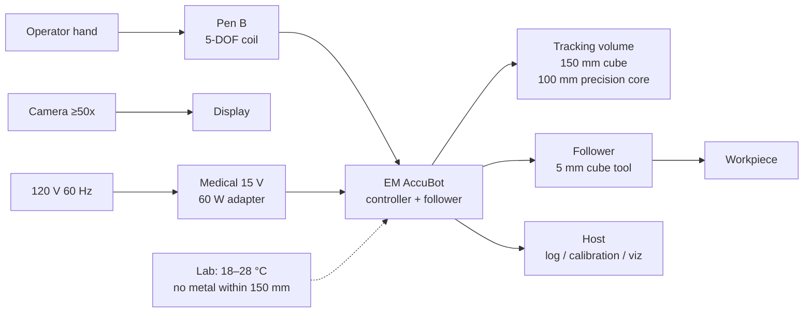
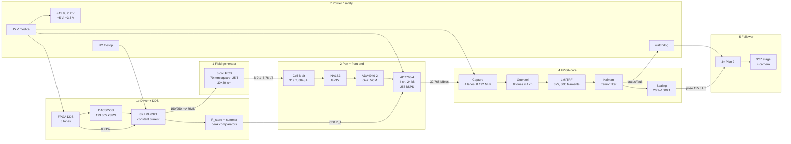
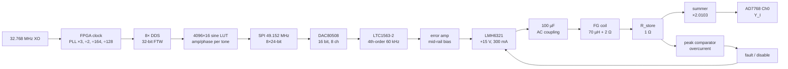
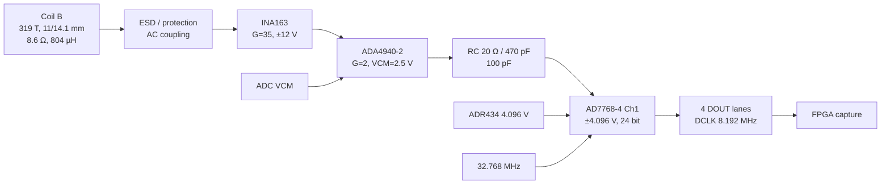
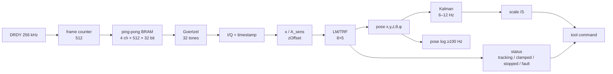
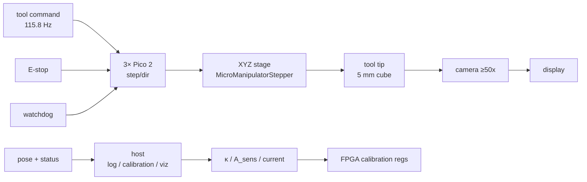
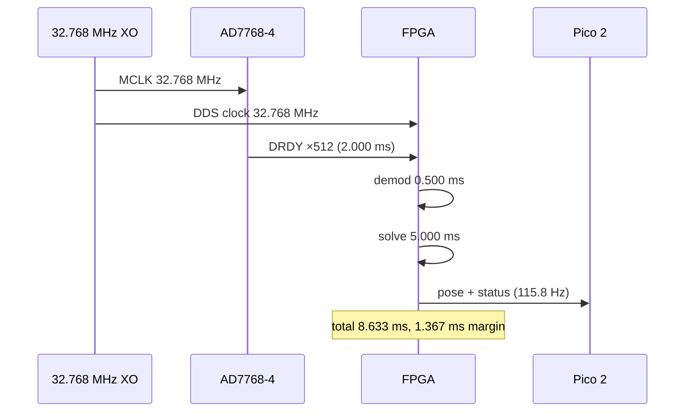
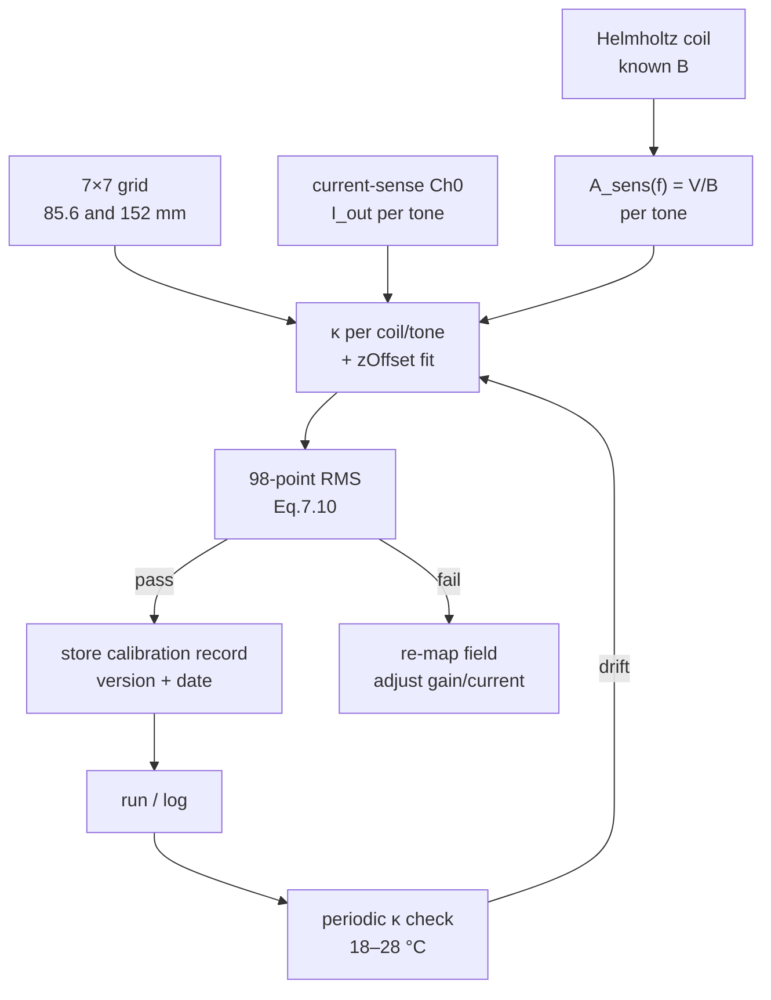
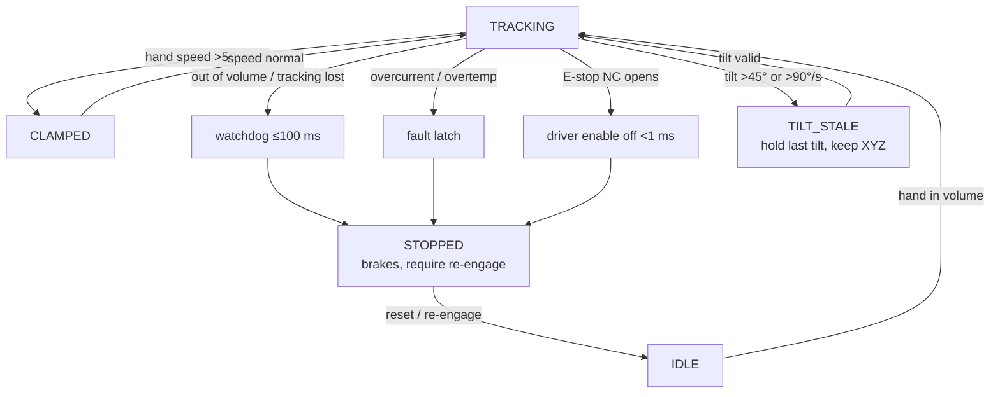

# Phase 2 — System flow chart (Rev A)

**Status:** Rev A draft, 2026-10-27. This is the design-review flow chart for the
Phase 2 report. It uses the recommended options in `decisions_log.md`; decisions
14–24 await the team's final approval. Test gates are in `design_order.md`.

**Drawing standard.** The report version must follow IEEE 315 / IEC 60617 for
symbols and signal flow (left-to-right signal, top-to-bottom power, red dashed
faults, blue dashed calibration). The Mermaid diagrams below are the source
for the drawing; the EDA schematic is `system_schematic.md`.

**One-line summary.** 8 coils transmit 8 tones; one pen coil receives the sum;
the AD7768-4 digitizes 4 channels on one clock; the FPGA demodulates, solves
5-DOF, filters tremor, scales, and commands the follower; the host only logs,
calibrates, and visualizes; a hardware E-stop cuts the driver independently.

---

## 1. L0 — Context

| External | Interface | Value |
|---|---|---|
| Operator hand | Pen motion | ≤2 mm / ≤1°, ±45° pitch/yaw, no roll |
| Wall power | 108/120/132 V, 60 Hz | one medical 15 V/60 W adapter |
| Workpiece | Tool tip | 5 mm cube, ≤25 µm @100:1 |
| Camera/display | Magnified view | ≥50× |
| Host | Ethernet/USB | pose log ≥100 Hz, calibration UI, viz; no pose solve |
| Environment | Lab | 18–28 °C, 30–60 % RH, no metal within 150 mm |

---

## 2. L1 — System blocks and flows

| Block | Owns | Key interface | Recommendation |
|---|---|---|---|
| 1 FG | 8-coil PCB, geometry, guard | B field per tone | FG-01, SC-04b |
| 1b Driver/DDS | 8 DACs, 8 current loops, current sense | I drive, \(Y_I\) | DRV-01/02/08, D3-A |
| 2 Pen/FE | Coil B, INA163, ADA4940-2 | \(V_s\), differential out | PEN-02, FE-01/04 |
| 3 ADC | AD7768-4, 4 ch, 4 lanes | 32.768 Mbit/s | SC-05, ADC-05 |
| 4 FPGA | DDS, capture, demod, solver, filter, scaling | pose 115.8 Hz | DIG-01…06 |
| 5 Follower | Pico 2, XYZ stage, camera | pose/status | RQ-M1…M17 |
| 6 Host | log, calibration UI, viz | pose log, κ | no pose solve |
| 7 Power/safety | adapter, rails, E-stop, watchdog | enables, faults | C1, DRV-05/07 |

---

## 3. L2 — Field generation and driver

**Signal values (150 mA prototype / 250 mA nominal / 500 mA max):**

| Point | 150 mA | 250 mA | 500 mA |
|---|---|---|---|
| Coil current | 150 mA RMS | 250 mA RMS | 500 mA peak max |
| Coil voltage at 34 kHz | 2.26 V RMS | 3.77 V RMS | 7.55 V peak |
| \(R_{store}\) voltage | 0.15 V RMS | 0.25 V RMS | 0.50 V peak |
| Summer per tone | 0.30 V RMS | 0.50 V RMS | 1.0 V peak |
| LMH6321 dissipation (8 ch, +15 V) | ~13 W | ~22 W (no cap) | not continuous |
| Recommended first test | **150 mA** | 250 mA fallback | short-term only |

The 8 tones are one per coil, ascending in `fSysSetup.m` order:
20, 22, 24, 26, 28, 30, 32, 34 kHz. The FG-1 field map may reassign the weakest
coil to 34 kHz; the tone set and spacing do not change.

---

## 4. L2 — Pen, front end, ADC

**Signal budget at the pen (coil B, 150 mm/B):**

| Tone | Field (weakest) | \(V_s\) | ×35 INA | ×2 diff | ADC |
|---|---|---|---|---|---|
| 20 kHz | 0.10 µT | 0.496 mV | 17.4 mV | 34.7 mV | 17 bits |
| 34 kHz | 0.10 µT | 0.843 mV | 29.5 mV | 59.0 mV | 16 bits |
| 20 kHz (strongest) | 5.76 µT | 28.6 mV | 1.00 V | 2.00 V | 49 % FS |
| 34 kHz (strongest) | 5.76 µT | 48.6 mV | 1.70 V | 3.40 V | 83 % FS |

The 70× chain keeps the strongest 34 kHz tone below ±4.096 V and the weakest
tone at 16–17 effective bits. The current-sense Ch0 is the \(Y_I\) reference;
the reference-sensor Ch3 is a fixed coil at the FG edge (D3-A).

---

## 5. L2 — FPGA pipeline

| Stage | Rate | Latency | Output |
|---|---|---|---|
| Capture | 256 kSPS/ch | 2.000 ms frame + 0.133 ms ADC | 4 × 512 × 32 bit |
| Demod | 115.8 Hz | 0.500 ms | 8 complex \(Y_V\), 8 \(Y_I\) |
| Solve | 115.8 Hz | 5.000 ms | 5-DOF pose |
| Filter | 115.8 Hz | ≤100 ms group delay | filtered pose |
| Scale | 115.8 Hz | <0.1 ms | tool command |
| Log | ≥100 Hz | timestamped | pose/status record |

The pipeline is 8.633 ms = 115.8 Hz; the 10 ms / 100 Hz requirement has 1.367 ms
margin. See `dig6_requirements.md` for the full budget.

---

## 6. L2 — Follower and host

**Follower states:** `IDLE` → `ENGAGED` (hand in volume, tracking valid) →
`CLAMPED` (hand speed >50 mm/s) → `STOPPED` (E-stop, tracking lost, jump >10 mm,
overcurrent, overtemp) → `IDLE` after re-engage. `TILT_STALE` holds the last good
tilt and keeps XYZ if valid. Stop ≤100 ms.

---

## 7. L3 — Timing and clock

| Clock | Divide | Rate | Destination |
|---|---|---|---|
| XO | ÷1 | 32.768 MHz | ADC MCLK, FPGA DDS |
| SCLK | ×3/2 | 49.152 MHz | DAC80508 |
| DAC update | ÷164 | 199.805 kSPS | 8 DAC words |
| ADC ODR | ÷128 | 256 kSPS | 4-channel frames |
| Frame | N=512 | 2.000 ms | integer-J window |

The exact FTWs are in `dig6_requirements.md` §1. The 2 kHz tones are
\(k\cdot262144\) in a 32-bit accumulator; no fractional word, no beat.

---

## 8. L3 — Calibration flow

Calibration does not need an extra ADC: Ch0 gives the per-tone current, the
Helmholtz coil gives \(A_{sens}(f)\), and the 7×7 grid gives κ/zOffset. The
record is versioned and loaded at boot.

---

## 9. L3 — Fault and stop flow

| Fault | Detect | Action | Time |
|---|---|---|---|
| E-stop | NC contact opens | cut +15 V driver enable, opto status | <1 ms |
| Tracking lost | no valid pose / out of volume | stop follower, flag | ≤100 ms |
| Overcurrent | per-coil peak comparator | disable channel, flag | <1 ms |
| Overtemp | board/coil sensor | disable, flag | ≤100 ms |
| Software hang | watchdog | stop follower, flag | ≤100 ms |
| Comm loss | host/Pico heartbeat | stop follower, flag | ≤100 ms |

The E-stop is independent of the FPGA. The FPGA only receives an opto-isolated
status and runs a separate software watchdog.

---

## 10. Traceability to the report

| Report figure | This document | Also in |
|---|---|---|
| L0 context | §1 | `README.md` §2 |
| L1 system | §2 | `design_order.md` §1 |
| Field/driver | §3 | `driver_power_requirements.md` |
| Pen/FE/ADC | §4 | `frontend_requirements.md`, `adc_interface_closure.md` |
| FPGA pipeline | §5 | `dig6_requirements.md` |
| Follower/host | §6 | `manipulator_requirements.md` |
| Timing | §7 | `tone_plan.md`, `dig6_requirements.md` |
| Calibration | §8 | `calibration_tooling.md` |
| Fault/stop | §9 | `driver_power_requirements.md` §6 |

**Open at the drawing level:** exact EDA symbols/footprints (KiCad), connector
pin numbers, and enclosure cut-outs. The interfaces and signal levels above are
proposed; freeze them after the team approves the decision sheet.
