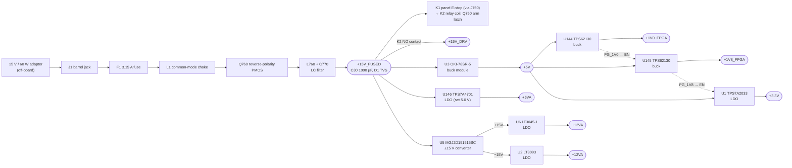

# BRD-01 power tree and inter-sheet connections

> **Partially superseded (2026-11-24, power-tree v2).** This page describes the
> v1 tree: `+5V` from an OKI-78SR, LDO-fed `+5VA`, and the `+5V`/`+3.3V` split.
> The schematic now implements [power_tree_v2.md](../../../docs/phase2/power_tree_v2.md):
> `+6V` from a TPSM63604 module, `+5V_EXC` and `+5VA` from TPS7A4701 LDOs, no
> `+5V` net, and hierarchical labels for the three crossing signals instead of
> global labels. The rail table and mermaid diagram below still show v1 and
> are kept only as the as-captured record at commit `4da4e95`.

This is the **as-captured** state of the KiCad schematic. It was generated from the
netlist of `brd-01.kicad_sch` (KiCad 10.0.8) on 2026-11-24, at commit `4da4e95`.
Where the design docs disagree with the schematic, the schematic is described
here and the mismatch is listed in [§7](#7-open-items-and-doc-mismatches).

Use it for two jobs:

1. Understand what every rail is, where it comes from and who uses it.
2. Redraw the sheets: which nets leave a sheet (power symbol or hierarchical
   label) and which stay local (wire them directly).

---

## 1. Power tree at a glance



Plain-text version of the same tree:

```text
Adapter 15 V ─ J1 ─ F1 ─ L1 (CMC) ─ Q760 (rev-pol) ─ L760/C770 ─┬─ +15V_FUSED
                                                                 │
   ┌─────────────────────────────────────────────────────────────┤
   │                                                             │
   ├─ K1 (panel E-stop, NC) ─ K2 coil ─ Q750 ◄─ arm latch        │
   ├─ K2 contact (NO) ─────────────────────────► +15V_DRV ──► driver: 8× LMH6321, U39, bias
   │
   ├─ U3 OKI-78SR-5 ──► +5V ──┬─ U144 TPS62130 ─► +1V0_FPGA ─► FPGA VCCINT, VCCBRAM
   │                          │      │ PG_1V0
   │                          ├─ U145 TPS62130 ─► +1V8_FPGA ─► FPGA VCCAUX, VCCADC
   │                          │      │ PG_1V8
   │                          ├─ U1 TPS7A2033 ──► +3.3V ─────► everything digital
   │                          ├─► driver: DAC80508 VDD, 8× LTC1563-2
   │                          └─► fpga: FT231X VCC
   │
   ├─ U146 TPS7A4701 (5.0 V) ─► +5VA ──► receiver: AD7768-4 AVDD, 2× ADA4940-2
   │
   └─ U5 MGJ2 ─┬─ +15V ─ U6 LT3045-1 ─► +12VA ─► driver op-amps, receiver INA163/ADR434
               └─ −15V ─ U2 LT3093 ───► −12VA ─► driver op-amps, receiver INA163
```

Everything returns to **one `GND` net**. The MGJ2 is an isolated converter,
but its `COM` and `−VIN` are both tied to `GND`, so the analog and digital
grounds are not isolated. Analog/digital separation is a layout job (ground
partitioning and return paths), not a schematic one.

---

## 2. Rail table

| Rail | Made by | Set by | Fed from | Enable / sequencing | Leaves power sheet to | Budget (doc) |
|---|---|---|---|---|---|---|
| `+15V_FUSED` | J1 → F1 → L1 → Q760 → L760 | adapter 15 V | adapter | always on once plugged in | — (power only) | 1.5 A typ / 3.0 A max |
| `+15V_DRV` | K2 relay NO contact | — | `+15V_FUSED` | only when E-stop closed **and** arm latch set ([§3](#3-e-stop-and-arm-latch)) | driver | 1.2 A typ / 2.0 A max |
| `+5V` | U3 OKI-78SR-5/1.5 | fixed, 4.8–5.2 V | `+15V_FUSED` | always on | driver, fpga | 0.8 A / 1.5 A |
| `+1V0_FPGA` | U144 TPS62130 | R190 49.9k / R191 200k → 1.00 V | `+5V` | EN tied to `+5V`: **first** | fpga | — |
| `+1V8_FPGA` | U145 TPS62130 | R193 249k / R194 200k → 1.80 V | `+5V` | EN = `PG_1V0`: **second** | fpga | — |
| `+3.3V` | U1 TPS7A2033 | fixed 3.3 V | `+5V` | EN = `PG_1V8`: **third** | driver, fpga, receiver, connectors | 0.2 A / 0.3 A |
| `+5VA` | U146 TPS7A4701 | ANY-OUT: 1.4 + 3P2V + 0P4V = 5.0 V | `+15V_FUSED` | EN tied to `+15V_FUSED`: always on | receiver | 80 mA / 150 mA |
| `+15V` | U5 MGJ2 +VOUT | fixed | `+15V_FUSED` | always on | — (power only) | 67 mA rating |
| `−15V` | U5 MGJ2 −VOUT | fixed | `+15V_FUSED` | always on | — (power only) | 67 mA rating |
| `+12VA` | U6 LT3045-1 | R3 121k on SET → 12.1 V; ILIM R4 750 Ω | `+15V` | EN/UV tied to its input: always on | driver, receiver | ≈58 mA max (bom-to-cad.md) |
| `−12VA` | U2 LT3093 | R1 121k on SET → −12.1 V; ILIM R2 7.5k | `−15V` | EN/UV tied to its input: always on | driver, receiver | ≈56 mA max (bom-to-cad.md) |

Notes:

- **FPGA order is 1.0 V → 1.8 V → 3.3 V.** That is the Artix-7 recommended
  order (VCCINT/VCCBRAM, then VCCAUX, then VCCO). The PG pull-ups R192/R195
  go to `+5V`.
- **The analog rails are not sequenced or monitored.** U146, U6 and U2 come up
  as soon as `+15V_FUSED` exists. The PG pins of U6 and U2 are no-connect.
- **The ±12VA chain is close to its limit.** The MGJ2 is rated 67 mA per rail.
  The screening estimate in [bom-to-cad.md](bom-to-cad.md) leaves about
  7–8 mA of margin per rail. Every op-amp added to ±12VA eats into that.
- TP760–TP763 are test points on `+15V`, `−15V`, `+12VA` and `−12VA`.

---

## 3. E-stop and arm latch

This is the only safety path that removes coil power. The FPGA can read its
state but **cannot arm it**. Arming takes a physical press of SW750.

```text
 +15V_FUSED ─ K1 NC (panel mushroom via J750) ─┬─ ESTOP_NC_15V ─┬─ K2 coil ─ K2_COIL_LOW ─ Q750 (D) ─ GND
                                                │                └─ D140 flyback across coil
                                                └─ R185 3.3k ─ ESTOP_LED ─ U143 TLP291 LED ─ GND

 U143 collector ─ ESTOP_ASSERTED (R186 10k pull-up to +3.3V) ──► FPGA U4.R2   (high = E-stop pressed)
       └─ U750 inverter ─ ESTOP_OK ─► U751 TPS3808 MR
                                       U751 also watches +3.3V (power-on / brownout)
                                       U751 RESET ─ ARM_POR_N ─┐
 DRIVER_FAULT_N (from driver comparators, also to FPGA U4.R1) ─ U752 AND ─ ARM_CLEAR_N ─► U753 CLR

 SW750 ─ ARM_PUSH_N ─ R752/C755 ─ ARM_DEBOUNCE ─ U754 Schmitt ─ ARM_CLK ─► U753 CLK  (D tied high)
 U753 Q ─ ARMED ─ R753 100 Ω ─ ARM_GATE (R754 100k pull-down) ─ Q750 gate

 K2 NO contact: +15V_FUSED ──► +15V_DRV
```

How it behaves:

| Event | What happens |
|---|---|
| Power-up or 3.3 V brownout | U751 holds `ARM_POR_N` low → latch cleared → K2 open. The board always starts **disarmed**. |
| E-stop pressed | K1 opens the K2 coil feed directly (relay drops) **and** `ESTOP_OK` low → latch cleared. Two independent paths. `ESTOP_ASSERTED` goes high to the FPGA. |
| Any coil overcurrent | Driver comparators pull `DRIVER_FAULT_N` low → latch cleared → K2 drops. The FPGA sees the same line. |
| SW750 pressed | Rising edge on `ARM_CLK` sets the latch → Q750 on → K2 closes → `+15V_DRV` live. This only works while no clear condition is active, because CLR is a level. |

K1 is drawn as `accubot:Draft_EStop_Mushroom_NC`. It is the off-board panel
switch, wired through J750, and it is excluded from the BOM and PCB. K2 is a
draft relay symbol too. Both stay drafts until the relay is chosen.

---

## 4. Who uses which rail, by sheet

| Rail | Power sheet | Driver | Receiver | FPGA | Connectors |
|---|---|---|---|---|---|
| `+15V_DRV` | K2 contact (source) | U20–U27 LMH6321 V+, U39 OPA192, R380/R382 bias, R600–R607 | — | — | — |
| `+5V` | U3 (source), U144/U145/U1 inputs | U10 DAC80508 VDD, U80–U87 LTC1563-2 (V+ and LP) | — | U142 FT231X VCC, ~RESET | — |
| `+1V0_FPGA` | U144 (source) | — | — | U4 VCCINT, VCCBRAM | — |
| `+1V8_FPGA` | U145 (source) | — | — | U4 VCCAUX, VCCADC | — |
| `+3.3V` | U1 (source), U750–U754 latch logic, U751 sense, R186 pull-up | U10 VIO, U60–U67 TLV3201, U600–U603 LVC2G07, R710–R735, R712 fault pull-up | U101 AD7768-4 IOVDD + PIN/SPI strap | U4 VCCO, U141 flash, U142 VCCIO, Y1 oscillator, J140 JTAG VREF, pull-ups | J123 pin 1 (3V3 to the Pico header) |
| `+5VA` | U146 (source) | — | U101 AVDD1A/1B/2A/2B, U105/U108 ADA4940-2 (+VS and ~DISABLE) | — | — |
| `+12VA` | U6 (source), TP762 | U30–U38 OPA192, U40–U43 OPA2192 | U102 ADR434, U103 OPA192, U104/U106/U107 INA163, BAS70 clamps | — | — |
| `−12VA` | U2 (source), TP763 | U30–U38, U40–U43 | U104/U106/U107 INA163, BAS70 clamps | — | — |
| `GND` | everything | everything | everything | everything (incl. VCCBATT) | USB, ESD, Pico header |

---

## 5. Signals that cross sheets

Direction is from the point of view of the sheet named in the left column.
FPGA balls are U4 on the FPGA sheet.

### Power ↔ FPGA / driver

| Net | Power sheet | Other end | Direction (power sheet) |
|---|---|---|---|
| `ESTOP_ASSERTED` | U143 collector, R186, U750 input | FPGA ball **R2** | output |
| `DRIVER_FAULT_N` | U752 input (clears the latch) | driver: U600–U603 open-drain + R712 pull-up; FPGA ball **R1** | input |
| `+15V_DRV` | K2 NO1 | driver | output (switched rail) |

### FPGA ↔ receiver (AD7768-4, U101)

| Net | FPGA ball | AD7768-4 pin | FPGA direction |
|---|---|---|---|
| `CLOCK_32M768` | D13 (+ Y1 oscillator output) | MCLK via R100 33 Ω | output (Y1 drives both) |
| `ADC_SCLK` | A13 | SCLK | output |
| `ADC_CS` | B12 (R164 pull-up) | ~CS | output |
| `ADC_SDI` | A12 | SDI | output |
| `ADC_SDO` | B11 | SDO | input |
| `ADC_RESET_N` | A14 (R163) | ~RESET | output |
| `ADC_START_N` | B14 (R165) | ~START | output |
| `ADC_SYNC_IN` | C14 (R166) | SYNC_IN | output |
| `ADC_SYNC_OUT` | A15 | SYNC_OUT | input |
| `ADC_DCLK` | C11 | DCLK | input |
| `ADC_DRDY_N` | B10 | ~DRDY | input |
| `ADC_DOUT0`…`3` | A8, A9, B9, A10 | DOUT0–3 | input |

### FPGA ↔ driver (DAC80508, U10)

| Net | FPGA side | Driver side | FPGA direction |
|---|---|---|---|
| `DAC_CS` | ball M2 → R145 33 Ω (R162 pull-up) | U10 ~CS, TP200 | output |
| `DAC_SCLK` | ball M1 → R146 33 Ω | U10 SCLK, TP201 | output |
| `DAC_SDI` | ball L4 → R147 33 Ω | U10 SDI, TP202 | output |
| `DAC_SDO` | ball M4 | U10 SDO/~ALARM, TP203 | input |

The 33 Ω series resistors sit on the FPGA sheet, so the label that crosses
the sheet boundary is on the **resistor side**, not the ball side.

### Driver ↔ receiver

| Net | Driver | Receiver | Driver direction |
|---|---|---|---|
| `CURRENT_SUM` | U38 OPA192 summer output (R200) | R110 → AD7768-4 Ch0 | output |

### Driver ↔ connectors (field generator)

| Net | Driver | Connector |
|---|---|---|
| `FG0_OUT`…`FG7_OUT` | coil drive output (coupling cap, TP on ch 0) | J20–J27 |
| `FG0_RETURN`…`FG7_RETURN` | R20–R27 1 Ω sense + R400…R470 | J20–J27 |

### Receiver ↔ connectors (sensors)

| Net | Receiver | Connector |
|---|---|---|
| `PEN1_P` / `PEN1_N` | R101 / R102 100 Ω (Ch1) | J122 |
| `PEN2_P` / `PEN2_N` | R540 / R541 100 Ω (Ch2) | J127 |
| `REF_COIL_P` / `REF_COIL_N` | R560 / R561 100 Ω (Ch3) | J128 |

### FPGA ↔ connectors (Pico and USB)

| Net | FPGA side | Connector | FPGA direction |
|---|---|---|---|
| `PICO_TX` | ball N2 | J123 | confirm against the ICD |
| `PICO_RX` | ball N3 | J123 | confirm against the ICD |
| `PICO_STOP_N` | ball P4 | J123 | output (active-low level, Pico pulls down) |
| `PICO_HEARTBEAT` | ball P3 | J123 | output (100 Hz toggle) |
| `USB_DP` / `USB_DM` | R160 / R161 27 Ω → FT231X | J124 USB-C, D750 ESD | bidirectional |
| `USB_VBUS` | R158 → FT231X CBUS2 (VBUS sense) | J124 | input |

---

## 6. How to draw it

### Rails: power symbols, not labels

Every rail above should be a **power symbol** on every sheet that uses it.
Power symbols are global in KiCad, so they need no sheet pins. Stock symbols
exist for `GND`, `+3.3V`, `+5V`, `+12VA`, `−12VA` and `+15V`. `+5VA`,
`+1V0_FPGA`, `+1V8_FPGA` and `+15V_DRV` need custom power symbols in the
project library, or hierarchical labels.

Right now the power sheet mixes both styles: GND appears as 47 global labels
and 17 power symbols, +3.3V as 16 labels and 1 symbol, +5V as 9 labels and
2 symbols. The other four sheets use only global labels.

### Signals: hierarchical labels (if you switch)

Hierarchical labels only connect through a matching **sheet pin** on the root
sheet. The root sheet has none today. So either:

- **Switch every sheet together**: every signal in [§5](#5-signals-that-cross-sheets)
  becomes a hierarchical label with the direction shown, plus a sheet pin on
  the root, wired between sheet blocks. This gives the readable top-level
  block diagram.
- **Or keep global labels for signals** and only clean up the rails and local
  nets.

Changing only the power sheet to hierarchical labels while the others keep
global labels will **disconnect** those nets.

Root-sheet pins per sheet if you switch:

| Sheet | Pins on its block |
|---|---|
| power | out: `ESTOP_ASSERTED`, `+15V_DRV`* · in: `DRIVER_FAULT_N` |
| driver | in: `+15V_DRV`*, `DAC_CS`, `DAC_SCLK`, `DAC_SDI` · out: `DAC_SDO`, `DRIVER_FAULT_N`, `CURRENT_SUM` · bidir: `FG0…7_OUT`, `FG0…7_RETURN` |
| receiver | in: `CLOCK_32M768`, `ADC_SCLK`, `ADC_CS`, `ADC_SDI`, `ADC_RESET_N`, `ADC_START_N`, `ADC_SYNC_IN`, `CURRENT_SUM` · out: `ADC_SDO`, `ADC_SYNC_OUT`, `ADC_DCLK`, `ADC_DRDY_N`, `ADC_DOUT0…3` · passive: `PEN1/2_P/N`, `REF_COIL_P/N` |
| fpga | mirror of receiver + DAC lists, in: `ESTOP_ASSERTED`, `DRIVER_FAULT_N`, `USB_VBUS` · `PICO_*` · bidir: `USB_DP`, `USB_DM` |
| connectors | `FG*`, `PEN*`, `REF_COIL_*`, `PICO_*`, `USB_DP/DM/VBUS` |

\* Only if `+15V_DRV` is a hierarchical label rather than a custom power symbol.

### Power sheet: what stays local

These nets never leave the power sheet:

| Net(s) | Now | Change to |
|---|---|---|
| `+15V_FUSED` | 7 global labels | wires, or a local label if the run is long |
| `+15V`, `−15V` | global labels and power symbols | wires (U5 → U6/U2 is short) |
| `ADAPTER_FUSED_RAW`, `ADAPTER_RETURN`, `CMC_POS`, `FILTER_PRE`, `REVERSE_GATE` | local labels | wires along the entry chain |
| `BUCK1/2_SW`, `BUCK1/2_FB`, `BUCK1/2_SS` | local labels | wires; keep a label on `SW` and `FB` if you want named PCB nets |
| `PG_1V0`, `PG_1V8` | local labels | wires from PG to the next EN |
| `5VA_NR` | local label | wire C189 to NR |
| `ARM_*`, `ARMED`, `ESTOP_OK`, `ESTOP_LED`, `K2_COIL_LOW` | local labels | wires inside the latch block |
| `ESTOP_NC_15V` | local label, 5 pins | one label pair is fine if K1/J750 sit far from K2 |

Suggested left-to-right layout for the power sheet, following the flow:

```text
[ Entry: J1 F1 L1 Q760 L760 C30 D1 ]  →  [ E-stop: J750/K1, K2, U143, latch U750–U754, Q750, SW750 ]
              │
              ├→ [ Digital: U3 → U144 → U145 → U1, sequencing left to right ]
              │
              └→ [ Analog: U146 (+5VA) | U5 → U6 (+12VA) / U2 (−12VA) ]
```

---

## 7. Open items and doc mismatches

| # | Item | Status |
|---|---|---|
| 1 | **+5VA source.** Schematic feeds U146 from `+15V_FUSED` (0.8–1.5 W in the LDO). The docs say "from +5 V_D". An LDO cannot make 5.0 V from the OKI (4.8–5.2 V out; TPS7A47 dropout 216 mV at 0.5 A). A 4.6 V setting is ruled out: AD7768-4 AVDD1 − AVSS is 4.5–5.5 V and the TPS7A47 is ±2.5%, so 4.6 V can land at 4.49 V. Proposed: a separate pre-buck from 15 V to about 6 V ahead of U146 (5.0 V), receiver-only. AD7768-4 fast-mode load is AVDD1 18.2/20.3 mA (up to 28.8/32.5 mA with reference buffers) + AVDD2 18.8/20.3 mA, typ/max. | **open: pick pre-buck part** |
| 2 | Analog converter chain. `system_schematic.md` §2 and decision #20 list RV-1515D + TPS7A47/TPS7A33. The schematic uses the approved MGJ2D151515SC + LT3045-1 + LT3093 (see [bom-to-cad.md](bom-to-cad.md)). | docs stale |
| 3 | ADR434. `system_schematic.md` §2 puts it on +5 V_A; the schematic powers it from `+12VA`. | docs stale |
| 4 | ±12VA headroom: about 7–8 mA left of the 67 mA MGJ2 rating. | verify on bench |
| 5 | Analog rails have no sequencing and no PG monitoring. | decide if needed |
| 6 | `+3.3V` from one 300 mA LDO feeds FPGA I/O, flash, oscillator, FT231X, the DAC I/O, eight comparators, the latch logic and the Pico header pin. Budget says 0.2 A typ / 0.3 A max. | verify load |
| 7 | `+15V` and `−15V` use power symbols. Those are global names, so any `+15V` symbol on another sheet would join the MGJ2 output. | rename to a local net when redrawing |
| 8 | K1/K2 are draft symbols, off the BOM. | relay selection open |
