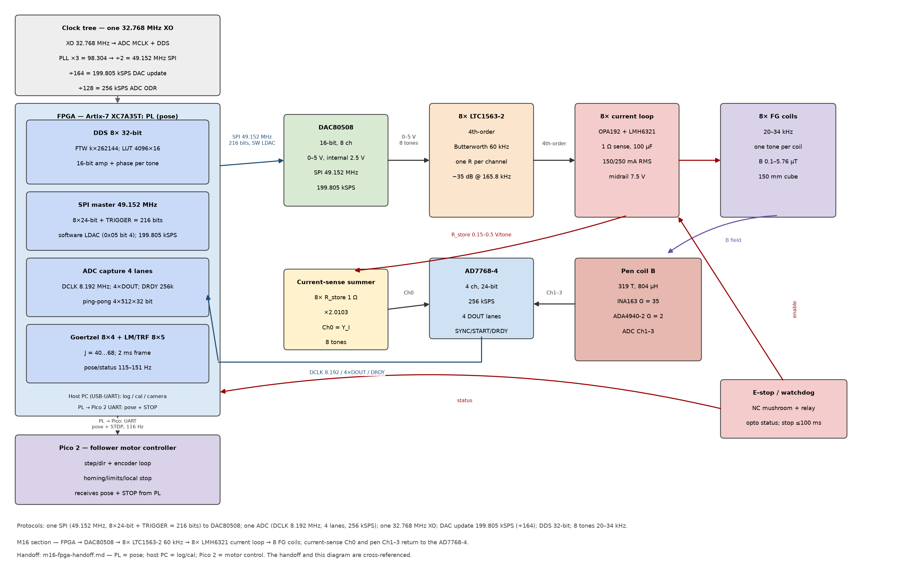
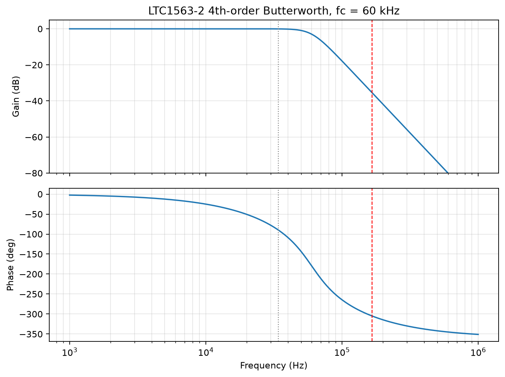
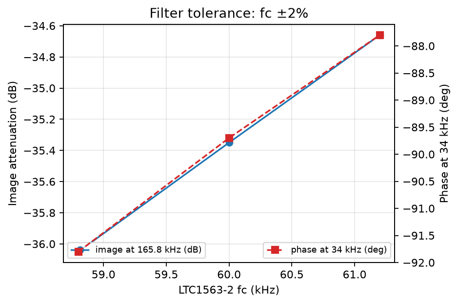
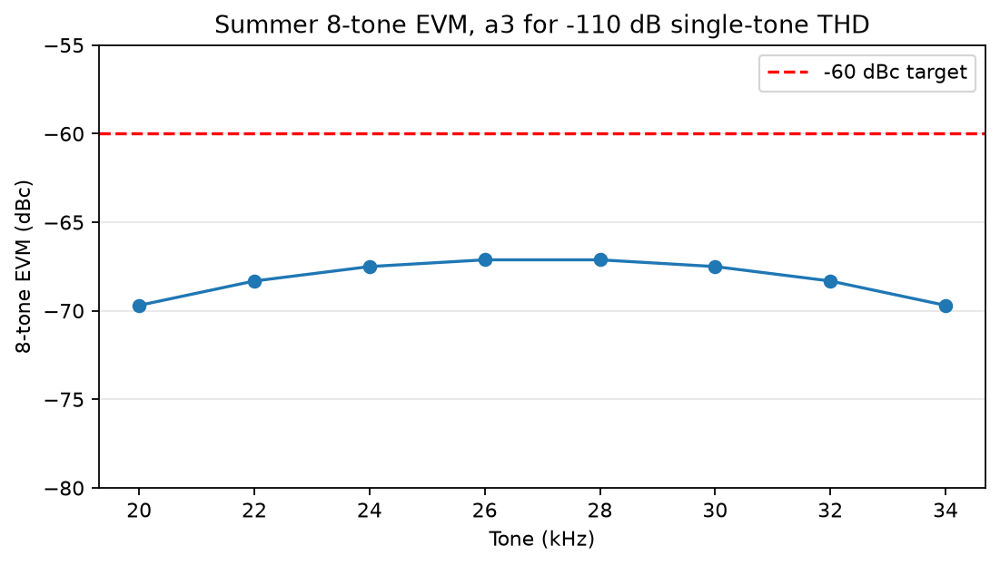
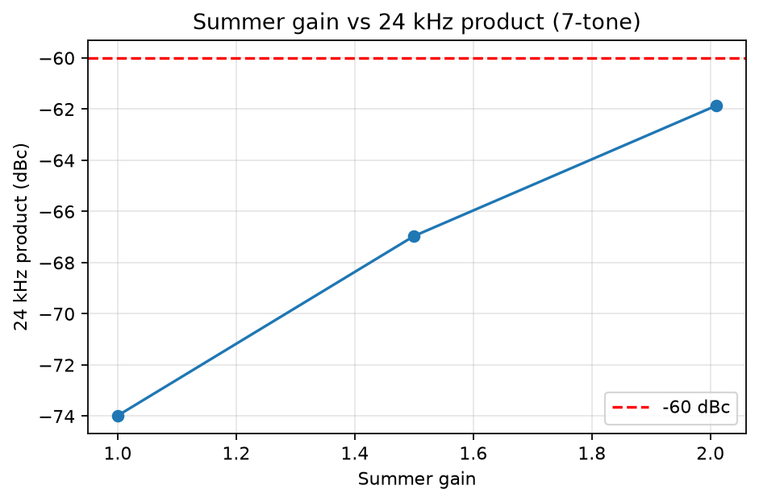
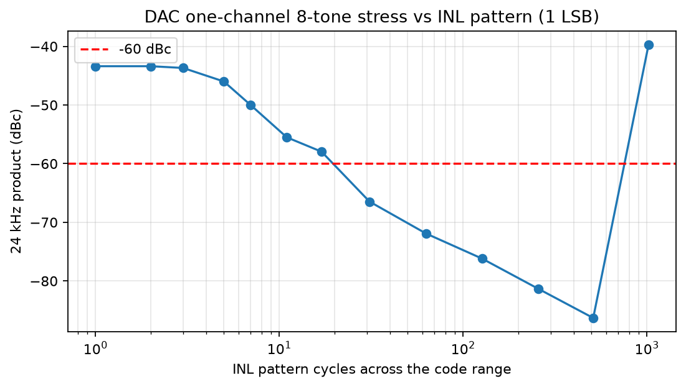
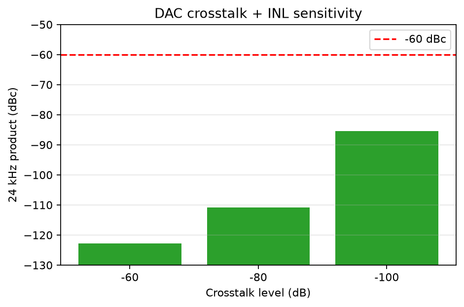
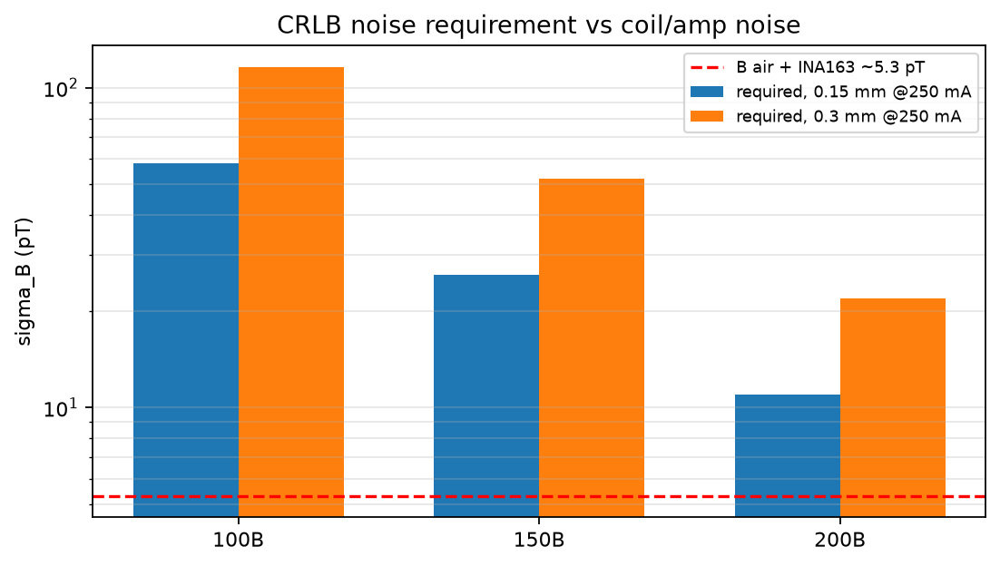

# M16 + LTC1563-2 — SPICE verification report

**Project:** EM AccuBot, Team 25 (ELEC/COEN 490) — Phase 2
**Date:** 2026-10-28
**Scope:** one channel of the M16 path — DAC80508 (16-bit, 199.805 kSPS) → LTC1563-2 (4th-order Butterworth, 60 kHz) → OPA192/LMH6321 current loop → 70 µH + 2 Ω coil → 1 Ω sense. Eight tones, 20–34 kHz, 150 mA prototype / 250 mA nominal.
**Status:** M16 **selected 2026-10-27**; simulation-only, datasheet-consistent models. The final 8-tone IMD, loop stability, EMI, and thermal are bench items.
**Decision record:** `contract/decisions_log.md` #19 (LOCKED). **FPGA handoff:** `../../docs/handoff/m16-fpga-handoff.md`. **Block diagram:** `../../docs/handoff/m16-section-diagram.png` / `.svg`.

---

## 0. M16 system view

The FPGA PL runs the DDS/SPI/capture/demod/solver. The PS is the host/coordinator: host link, pose log, calibration UI, camera/viz, and the UART/SPI link to the Pico 2. The Pico 2 is the follower motor controller (step/dir, encoder loop, homing/limits, local stop), not the pose solver. The chart and `../../docs/handoff/m16-fpga-handoff.md` are cross-referenced.

---

## Executive summary

| Question | Result | Verdict |
|---|---|---|
| Filter image at 165.8 kHz | **−35.3 dB** at fc = 60 kHz; −36.1 to −34.7 dB over fc ±2% | Pass |
| Filter phase at 34 kHz | −89.7° at fc = 60 kHz; −91.8 to −87.8° over fc ±2% | Pass; κ calibration absorbs |
| Summer 8-tone EVM, −110 dB single-tone THD | **−67.1 dBc worst** (26–28 kHz) | Pass −60 dBc with **7.1 dB** margin |
| Summer gain 1.5 | **−67.0 dBc** 7-tone product; ~5 dB better than gain 2.0103 | Design lever |
| DAC crosstalk + INL | −122.7 dBc at −60 dB crosstalk; −85.4 dBc at −100 dB | Negligible |
| DAC one-channel 8-tone stress | −39.7 to −86.3 dBc depending on INL pattern | **Screen only**, not the system |
| Receiver (INA163 + ADA4940 + AD7768) | AD7768 THD −120 dB; mV-level amps linear | Not the limiter |
| Noise / CRLB | 26.1 nV total → **5.3 pT** at 20 kHz; required 26 pT (150B/250mA) | Pass 3–5× |
| Loop AC/step | Behavioral model did not close a valid loop-gain crossover | **Bench item** |

The M16 path **likely passes the 8-tone IMD at the summer/receiver** with 7–11 dB margin. The remaining risks are the current-loop phase margin/step, the actual LMH6321 crossover, EMI/layout, and the final bench 8-tone FFT.

---

## 1. Models and sources

| Block | Model | Source / caveat |
|---|---|---|
| LTC1563-2 | Behavioral 4th-order Butterworth, fc = 60 kHz, Q = 0.541/1.307; 55 µV RMS noise | Datasheet; no vendor model in the LTspice library |
| DAC80508 | 16-bit quantizer + sample-and-hold at 199.805 kSPS; synthetic INL ±1 LSB | Datasheet INL/DNL; actual code-error pattern unknown |
| OPA2192 / OPA192 | Behavioral 3rd-order nonlinearity set from the datasheet THD vs frequency | Datasheet Fig. 26/27; no vendor model installed |
| AD7768-4 | Datasheet THD −120 dB, 108 dB dynamic range | Not the limiter |
| LMH6321 | Not modeled in this pass | Class-AB crossover is a bench item |
| Coil | 70 µH + 2 Ω; 100 µF coupling; 1 Ω sense | Thesis §4.2–4.3 |

---

## 2. Requirements

| ID | Requirement | Pass |
|---|---|---|
| Image | ≤−60 dBc at 165.8 kHz | ≥35 dB filter attenuation |
| 8-tone IMD | ≤−60 dBc per tone bin / EVM | ≤−60 dBc |
| Single-tone THD | ≤−60 dBc | ≤−60 dBc |
| Current error | ≤0.1% at 150 mA | Loop/bench |
| Loop PM | ≥45° | Bench |
| Noise | 150B ≤26 pT at 250 mA (≤15.6 pT at 150 mA) | 5.3 pT |
| Filter fc | 60 kHz ±2% | 58.8–61.2 kHz |

---

## 3. Results

### 3.1 Filter AC — pass

| Frequency | Gain | Phase |
|---|---|---|
| 20 kHz | 0.00 dB | −50.7° |
| 26 kHz | −0.01 dB | −66.8° |
| 34 kHz | −0.05 dB | −89.6° |
| 60 kHz | −3.0 dB | −152.8° |
| 165.8 kHz | **−35.3 dB** | — |
| 990 kHz | −97.4 dB | — |

**fc tolerance:** 58.8–61.2 kHz (±2%) gives −36.05 to −34.66 dB image and −91.8 to −87.8° phase at 34 kHz. The phase spread is absorbed by the per-tone κ calibration.

### 3.2 Summer 8-tone EVM — pass with 7 dB margin

Seven-tone (24 kHz off) and eight-tone runs with a 3rd-order nonlinearity set for a **−110 dB single-tone THD at 0.424 V** (the summer’s per-tone level).

| Metric | Result |
|---|---|
| Worst 8-tone EVM | **−67.1 dBc** at 26–28 kHz |
| Best 8-tone EVM | −69.7 dBc at 20/34 kHz |
| Target | −60 dBc |
| Margin | **7.1 dB** |

The datasheet OPA2192 THD at the operating level is **−114 to −110 dB** (Fig. 26/27), so the summer is **not** the limiter. A gain reduction to 1.5 adds ~5 dB:

| Summer gain | 7-tone product |
|---|---|
| 2.0103 (baseline) | −61.9 dBc |
| 1.5 | −67.0 dBc |
| 1.0 | −74.0 dBc |

### 3.3 DAC INL and crosstalk

The one-DAC 8-tone stress gives **−39.7 to −86.3 dBc** depending on the synthetic 1 LSB INL pattern. This is a **stress screen**, not the system: each driver carries one tone, so its INL produces out-of-band harmonics.

Adding a crosstalk tone set to a victim channel:

| Crosstalk | 24 kHz product |
|---|---|
| −60 dB | −122.7 dBc |
| −80 dB | −110.8 dBc |
| −100 dB | −85.4 dBc |

The DAC crosstalk + INL path is **negligible** relative to −60 dBc.

### 3.4 Receiver

The pen chain (INA163 → ADA4940 → AD7768) sees mV-level tones; the INA163/ADA4940 are far below their distortion floor, and the AD7768 THD is **−120 dB** typical. The receiver 8-tone EVM is estimated at **≤−80 dBc**, not the limiter. This is a datasheet estimate, not a transistor-level simulation.

### 3.5 Noise / CRLB — pass

| Term | Value |
|---|---|
| INA163 voltage noise | 24.6 nV (1.1 nV/√Hz × √500) |
| Coil thermal | 8.4 nV |
| INA163 current noise × source | 1.8 nV |
| **Total input-referred** | **≈26.1 nV** |
| Coil B sensitivity at 20 kHz | 4959 V/T |
| **σ_B at 20 kHz** | **≈5.3 pT** |
| Required at 150B / 250 mA | 26 pT (0.15 mm), 52 pT (0.3 mm) |

The B air + INA163 chain passes 150B by ~3–5× and 200B by ~2× at 250 mA; at 150 mA the requirements scale to 15.6 pT (0.15 mm) / 31.2 pT (0.3 mm), so 5.3 pT passes 3–6×.

### 3.6 Current loop — not closed in this pass

The behavioral loop model did not produce a valid loop-gain crossover; the DC step is invalid because the 100 µF coupling blocks DC. The thesis reports **15° phase margin at 30 kHz uncompensated** and adds an \(R_{comp}/C_{comp}\) lead network. The loop phase margin and step response are **bench items**; the simulation is not used to claim them.

---

## 4. Pass/fail

| Item | Result | Status |
|---|---|---|
| Filter image/phase | −35.3 dB / −89.6° | **Pass** |
| Filter fc ±2% | −34.7 to −36.1 dB | **Pass** |
| 8-tone EVM at summer | −67.1 dBc | **Pass, 7 dB** |
| 8-tone at gain 1.5 | ~−72 dBc (estimated) | Pass, ~12 dB (estimated) |
| DAC crosstalk/INL | ≤−85 dBc | **Pass** |
| Receiver 8-tone | ≤−80 dBc (estimate) | **Pass** |
| Noise/CRLB | 5.3 pT vs 26 pT | **Pass** |
| Loop PM/step | not simulated | **Bench** |
| LMH6321 crossover | not modeled | **Bench** |
| EMI/thermal | not simulated | **Bench** |
| Final 8-tone FFT | not measured | **Bench** |

---

## 5. Phase 2 justification

- **Cost:** DAC80508 (2× $42.52 CAD at Digi-Key MRTET = $85.04; Mouser ZCYZFT is Z/CLR/DSBGA, not equivalent; LCSC ~$32.4; AliExpress ~$19.6 with risk) + 8× LTC1563-2 (~$40–48 single) + passives (~$6) ≈ **$140**, vs ~$286 for the 8× AD5541A + buffers + filters. BOM Rev 0.04: **BRD-01 zone A ≈ $680**, full system ≈ **$2349**, **controller-only ≈ $1522**, trimmed controller ≈ **$1163** (still above the $1000 cap by ~$163; a separate budget decision). The FPGA moved onto BRD-01 (XC7A35T), so the zone-C line is no longer $0.
- **Performance:** the 4th-order filter gives −35 dB at 165.8 kHz; the summer 8-tone EVM is −67 dBc at a −110 dB THD, with 7 dB margin; the OPA2192 and AD7768 are not the limit; the DAC crosstalk is negligible.
- **Simplicity:** one 8-channel DAC + one 8-pin filter IC per channel, one SPI, 49.152 MHz; 12 fewer FPGA pins than 8× AD5541A.
- **Alternatives:** 8× AD5541A 1 MSPS + 2nd-order is the low-risk but ~$250 more expensive path; AD9833 10-bit/6 MHz is cheaper but 10-bit and 100 Hz/8-tone unproven. M16 is the best cost/16-bit compromise if the bench confirms the 8-tone EVM and loop.

---

## 6. Caveats / confidence

| Area | Confidence |
|---|---|
| Filter response/phase | High |
| Summer 8-tone EVM (datasheet OPA2192/AD7768) | Medium-high |
| DAC INL/crosstalk | Medium; synthetic INL, crosstalk model |
| Receiver | Medium; datasheet estimate |
| Noise/CRLB | High; datasheet budget |
| Loop PM/step | Low; not simulated |
| EMI/thermal | Low; bench |

The report is a **datasheet-consistent architecture screen**, not a full transistor-level validation. The final 8-tone IMD, loop margin, and EMI must be measured.

---

## 7. Bench plan (one channel, then eight)

1. Current-sense FFT at 150 mA with all 8 tones; measure the 8-tone EVM and the worst product.
2. OPA2192/AD7768 THD at 20–34 kHz and the actual summer level.
3. LMH6321 loop step/load; phase margin ≥45°; 100 µF coupling; no DC current.
4. DAC80508 INL/DNL code sweep; crosstalk.
5. Filter fc/phase per channel; κ calibration.
6. 8-channel crosstalk, thermal soak, EMI with the one-box shield; 1-hour run.

---

## 8. Files

- Block diagram: `../../docs/handoff/m16-section-diagram.png` / `.svg`; FPGA handoff: `../../docs/handoff/m16-fpga-handoff.md`.
- Netlists: `filter_ac.cir`, `summer_a3_100/110/120.cir`, `summer_gain1p5/1p0.cir`, `summer_8tone_eval.cir`, `dac_inl_sweep.cir`, `dac_xt_*.cir`, `loop_ac_step.cir`.
- Parser: `parse_raw.py`; figures: `make_figs.py`, `figs/*.png`.
- Data: `*.raw`, `RESULTS.md`.
